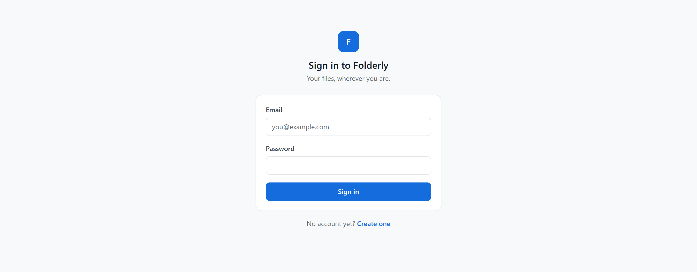
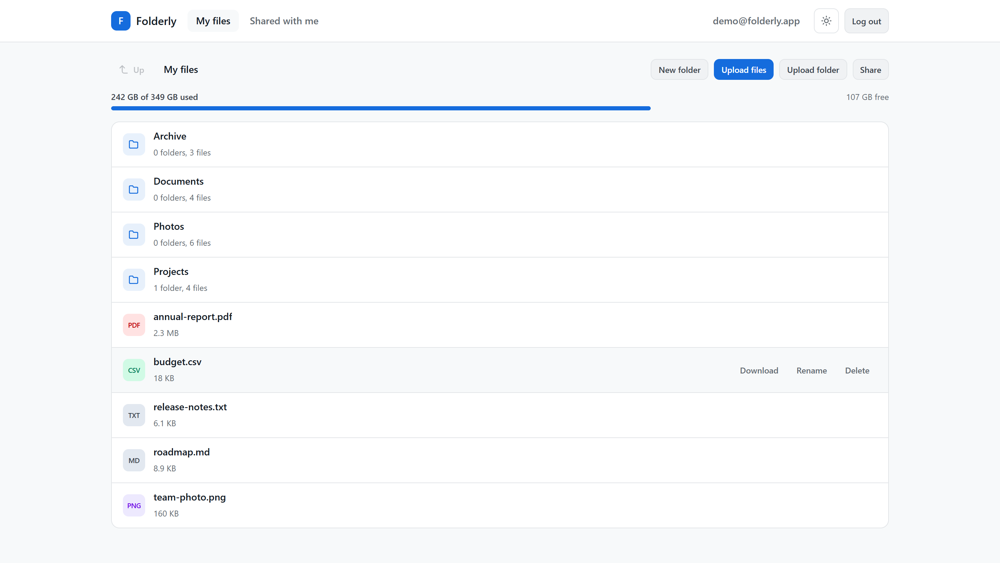
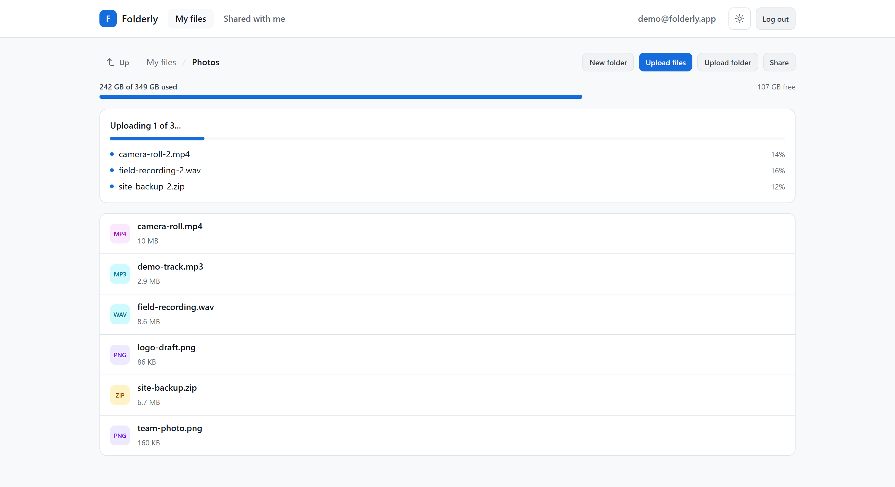
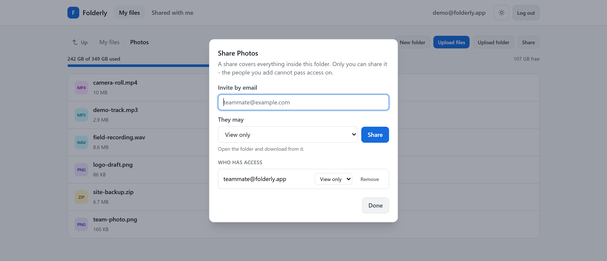
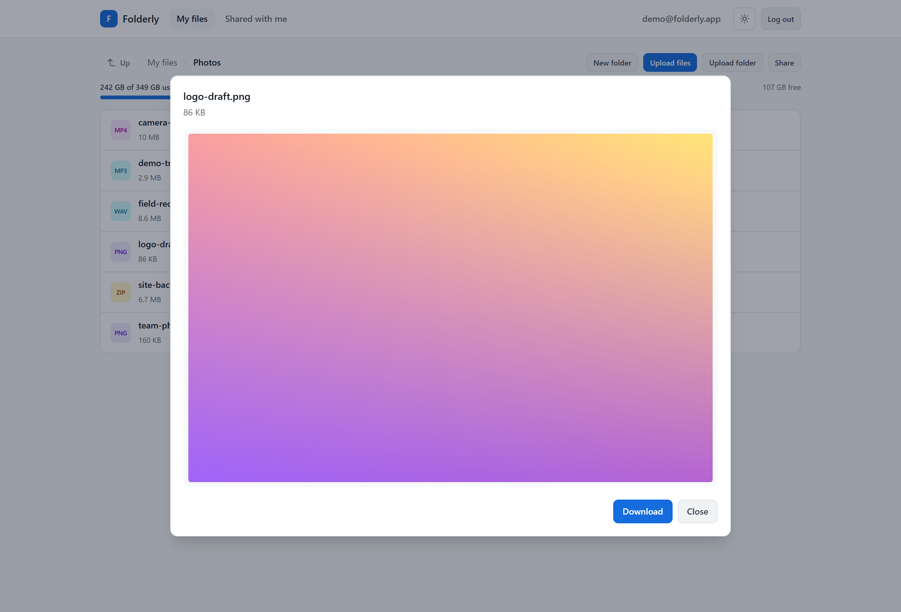
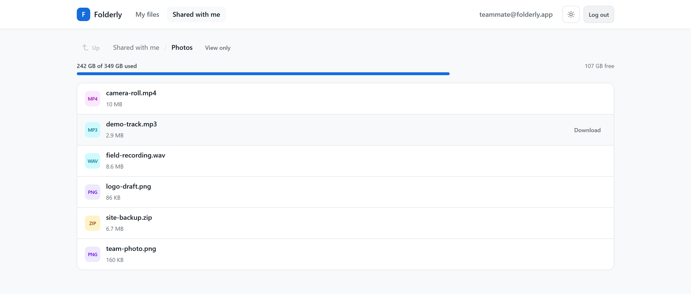
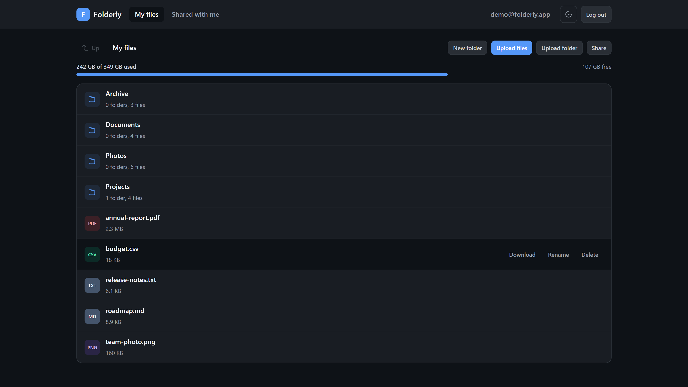

<h1 align="center">Folderly</h1>

<p align="center">
  Self-hosted file storage with folder sharing - a small, honest Google Drive you run yourself.
</p>

<p align="center">
  <a href="https://github.com/UltiPro/Folderly/actions/workflows/ci.yml">
    
  </a>
  
  
  
  
  
</p>

---

## Overview

Folderly gives a handful of people - a family, a team, a couple of machines - a private place to keep
files, and a way to hand a folder to someone else without handing over the account. It is a REST API
with a Vue single-page frontend, packaged as two Docker images small enough for a Raspberry Pi
and portable enough for anything else.

Four decisions shape the whole project:

- **Clients never see the storage layout.** Every path a client sends is relative to a _space_ - your
  own files, where `/` is your root, or a folder someone shared with you, where `/` is that folder.
  User ids and real paths never appear in the API.
- **A share is a role, not a password.** `read`, `add` or `edit`, granted per person per folder,
  inherited downwards, and cumulative: a share further down a path can widen access, never narrow it.
- **Registration is open, access is not.** A new account can log in and manage itself but cannot
  touch a single file until it redeems an activation code that the instance owner generates by hand.
- **A stolen token is not enough.** Every token is bound to the account it was issued for and stops
  working the moment that account changes its password, and changing a password or deleting an
  account takes the current password, not merely a valid session.

> [!NOTE]
> **Project status.** Complete and running. 124 backend tests and 89 frontend tests run in CI,
> alongside the linters and a smoke test against the freshly built image, before anything is
> published, a systemd timer on the host pulls what passed.

## Features

**Your files**

- Browse, create, rename and delete folders, with sizes, file types and item counts in the listing.
- Upload files or whole folders by drag and drop, three at a time, each with its own progress.
- Download, rename and delete files up to 100 MB.
- Preview images, PDFs and text in the browser without downloading them.
- Watch how much of the disk is left on the storage bar.

**Sharing**

- Share any folder by email as `read`, `add` or `edit`, change that role later, or revoke it.
- See who has access to a folder of yours, and with which role.
- Open a folder shared with you as its own space, with only the actions your role allows.

**Your account**

- Register, activate with a code, change your email or password, delete the account and its files.
- Hand out activation codes to decide who may use your instance.
- Switch between the light and the dark theme.

## Tech stack

| Layer    | Technology                                                            |
| -------- | --------------------------------------------------------------------- |
| API      | Python 3.14, Flask 3.1, flask-smorest, marshmallow, webargs           |
| Auth     | Flask-JWT-Extended, passlib (`pbkdf2_sha256`)                         |
| Database | SQLite via SQLAlchemy and Flask-SQLAlchemy                            |
| Serving  | gunicorn with `gthread` workers                                       |
| API docs | OpenAPI 3 and Swagger UI, served by the application                   |
| Frontend | Vue 3.5, Vite 8, TypeScript, Pinia, Vue Router, axios, Tailwind CSS 4 |
| Tests    | pytest (unit and integration), Vitest, an HTTP smoke test             |
| Tooling  | ruff, oxlint, ESLint, Prettier, Docker, GitHub Actions, Caddy         |

## Repository layout

```
Folderly/               compose.yaml - both halves locally, as the host runs them
├── Backend/            Flask REST API
│   ├── models/         SQLAlchemy models
│   ├── resources/      One blueprint per endpoint group
│   ├── utils/          Access control, activation, disk, validation
│   └── tests/          pytest suite plus the HTTP smoke test
└── Frontend/           Vue 3 single-page app - stock create-vue layout under src/
deploy/                 Production compose file, Caddyfile, systemd units, backup script
docs/                   Deployment guide and the screenshots below
scripts/                ci-local.ps1 - every CI gate, run locally
.github/workflows/      CI/CD pipeline
```

## Quick start

### From the published image

The image is published for `amd64` and `arm64` under one tag, so the same command works on a server
and on a Raspberry Pi. It is the API alone - for the interface as well, run the pair from source
below, or the published pair through the deployment guide.

```bash
mkdir -p folderly/files folderly/db
# The image runs as UID 10001 and these are bind mounts, so ownership comes from
# the host - without this the database cannot be created and the container exits.
sudo chown -R 10001:10001 folderly/files folderly/db

docker run -d --name folderly -p 5000:5000 \
  -e DISK_PATH=/data \
  -e DB_DIR=/db \
  -e JWT_SECRET_KEY="$(openssl rand -hex 32)" \
  -v "$PWD/folderly/files:/data" \
  -v "$PWD/folderly/db:/db" \
  ghcr.io/ultipro/folderly-backend:latest
```

> [!TIP]
> On Windows run this from PowerShell, with `-v "${PWD}\folderly\files:/data"`
> and without the `chown` - Docker Desktop keeps the files in its own virtual machine, where
> host ownership does not apply. Do not use Git Bash: it rewrites absolute paths, so the volumes
> land inside that machine and the data silently never reaches the directories you created.

Registration is open, but a new account can do nothing until it redeems a code - so generate one
before you sign up, or you will be locked out of your own instance:

```bash
docker exec folderly flask --app "app:init()" codes new --label "me"
```

The code is printed once, the database keeps only its hash. Now open <http://localhost:5000/swagger-ui>,
call `POST /register`, then `POST /login`, paste the `access_token` into **Authorize**, and redeem the
code with `POST /user/activate`.

### From source

```bash
git clone https://github.com/UltiPro/Folderly.git
cd Folderly/Folderly                   # Backend/ and Frontend/ side by side
cp Backend/.env.example Backend/.env   # fill in JWT_SECRET_KEY
docker compose up --build              # http://localhost:8080
```

That is both images, the pair production runs, from the same two Dockerfiles, so the whole
application answers on one origin with `/api` proxied to the API beside it. For the API alone, with
no SPA and no Caddy, run `docker compose up --build` from `Backend/` instead.

The two halves below run it without Docker, which is what work on the frontend wants.

**The API without Docker**, in a virtualenv. `DISK_PATH` and `DB_DIR` in `.env` are _container_
paths, so point them at local directories first - real environment variables take precedence over
the file - and create them before starting: the application checks both rather than creating them,
since a missing directory almost always means a wrong setting.

```powershell
pip install -r requirements.txt
mkdir folderly-data, folderly-db
$env:DISK_PATH = "$PWD\folderly-data"
$env:DB_DIR = "$PWD\folderly-db"
flask --app "app:init()" run
```

**The SPA with hot reload**, which needs the API already running. It expects it at
`http://127.0.0.1:5000`, copy `.env.example` to `.env.local` and set `VITE_API_BASE_URL` to point
it elsewhere, and whichever origin serves it must appear in the backend's `CORS_ORIGINS`.

```bash
cd Folderly/Frontend
npm install
npm run dev              # http://localhost:5173
```

The same activation code is needed here, from a compose stack it comes from the directory the
stack was started in:

```bash
docker compose exec app flask --app "app:init()" codes new --label "me"
```

## Configuration

Read from the environment at startup. The first three are required - the application refuses to start
without them rather than failing later on someone's first upload.

| Variable                   | Default | Purpose                                                                                                                                                                                  |
| -------------------------- | ------- | ---------------------------------------------------------------------------------------------------------------------------------------------------------------------------------------- |
| `DISK_PATH`                | -       | Root of the file storage. Must exist.                                                                                                                                                    |
| `DB_DIR`                   | -       | Directory holding `folderly.db`. Must exist, and **must not be inside `DISK_PATH`** - that is the tree the API serves files from, where one path-handling bug could expose the database. |
| `JWT_SECRET_KEY`           | -       | Token signing key. Changing it logs everyone out.                                                                                                                                        |
| `CORS_ORIGINS`             | `*`     | Comma-separated origins the frontend may call from.                                                                                                                                      |
| `DISK_USAGE_LIMIT_PERCENT` | `85`    | Fill level at which uploads start being refused with `507`.                                                                                                                              |
| `WEB_CONCURRENCY`          | `2`     | gunicorn worker processes.                                                                                                                                                               |
| `GUNICORN_THREADS`         | `4`     | Threads per worker, concurrency is workers x threads.                                                                                                                                    |
| `GUNICORN_TIMEOUT`         | `120`   | Seconds before a stuck worker is killed. Slow uploads are not affected.                                                                                                                  |

## API

Swagger UI at `/swagger-ui`, the raw specification at `/openapi.json`. Reads take their arguments
from the query string, writes take a JSON body, uploads are `multipart/form-data`. Every failure
answers the same shape - `{code, status, message}`, with per-field detail added on a validation
error - so a client reads `message` and never has to guess.

| Group   | Endpoints                                                        |
| ------- | ---------------------------------------------------------------- |
| Auth    | `POST /register`, `POST /login`, `POST /refresh`, `POST /logout` |
| Account | `GET/PUT/DELETE /user`, `POST /user/activate`                    |
| Folders | `GET/POST/PUT/DELETE /folder`, `GET /folder/list`                |
| Files   | `POST/GET/PUT/DELETE /file`, `GET /file/download`                |
| Access  | `GET /folder/shared`, `GET/POST/DELETE /folder/share`            |
| Disk    | `GET /disk`                                                      |
| Health  | `GET /hello`                                                     |

## Development

```bash
cd Folderly/Backend
pip install -r requirements-dev.txt

pytest
ruff check .

# Against a server that is already running, with a code from `codes new`:
python tests/smoke.py http://localhost:5000 K7M2-PX94-TB3H-QR8F
```

Every test builds its own application on a temporary `DISK_PATH` and `DB_DIR` and creates its accounts
through the API, so the suite needs no setup and touches no real data. `tests/smoke.py` is not
collected by pytest: it walks one account through a **running** server, which is the only way to
exercise gunicorn, the volumes and the image itself.

From `Folderly/Frontend`:

| Command              | What it does                                               |
| -------------------- | ---------------------------------------------------------- |
| `npm run dev`        | Dev server with hot reload, on <http://localhost:5173>.    |
| `npm run build`      | Type-check, then build to `dist/`.                         |
| `npm run test:unit`  | Vitest in watch mode (`npx vitest run` for a single pass). |
| `npm run lint`       | oxlint + ESLint, both with `--fix`.                        |
| `npm run format`     | Prettier over the frontend.                                |
| `npm run type-check` | `vue-tsc` on its own.                                      |

`npx vitest run` is 89 tests: the pure logic in `utils/`, the upload queue's concurrency limit and
weighted progress, and five specs covering traps that are invisible in the source.

`scripts/ci-local.ps1` runs every gate CI runs - both linters and test suites, the type-check, and
the smoke test against a container it builds and throws away on port 5050 - and prints one
pass/fail table at the end. PowerShell only, and the smoke step needs Docker.

## Deployment

A push to `main` runs three gates in parallel - ruff and pytest, the frontend's type-check, unit
tests and linters, and a smoke test over HTTP against the freshly built image - and only then builds
for real: two images, `folderly-backend` and `folderly-web` (Caddy with the built SPA inside), each
on native `amd64` and `arm64` runners, published to GHCR as one manifest per image under `latest`
and `sha-<commit>`, the full forty characters. Hosts follow `latest`, pinning a `sha-` tag is
the rollback.

**Nothing in the workflow names this account.** It publishes to
`ghcr.io/<repository owner>/folderly-backend` and `-web`, so a fork builds its own pair under its
own login with no edit anywhere - or you can skip building and run the images this repository
publishes.

`VITE_API_BASE_URL` is a **build** argument, not a runtime one - Vite inlines it into the
JavaScript, so the published image is fixed to the relative `/api`. That is what lets one image
serve any domain, and why the browser never makes a cross-origin request in production.

**[Putting it on your own host](docs/deployment.md)** - Docker, the two files to fetch, the five
values to fill in, the update timer, backups, rollback, and the split-host arrangements.

## Preview

**The way in.** Registration is open to anyone, what it gets you is an account that can do nothing
until it redeems a code.



**Your own space.** Folders first, then files, each with its size and what it is.



**Three uploads at a time**, each with its own progress, because the backend serves eight threads in
total. Navigating away mid-batch does not redirect the rest.



**A share is a role.** The owner invites by email and picks what that person may do, nobody else can
pass the access on.



**Previews never hand the file to the browser as a document.** Images and PDFs become object URLs,
text is read into a `<pre>`, so an uploaded `.html` is shown as source rather than run.



**The same folder as the person it was shared with sees it:** the name alone - never where it sits in
the owner's tree - a badge for their role, and a toolbar with nothing on it they are not allowed to
do.



**The theme is chosen, not sniffed**, and the browser chrome follows it.



## License

MIT - see [LICENSE](LICENSE). Run it, change it, redistribute it, build on it commercially if
you like, keep the copyright notice, and note that it comes with no warranty of any kind.
